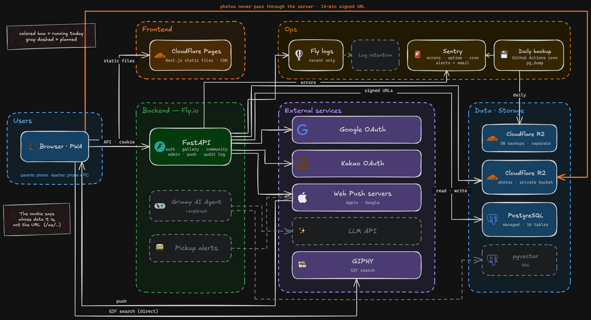

# 그림숲 — 동네 미술학원 하나를 혼자 짓고 운영합니다

> 🇬🇧 English: [README.md](./README.md) · 이 저장소의 상세 문서(`docs/`)와 그림은 영어로 씁니다.

**[grimsup.com](https://grimsup.com)** · 2026-08-29 공개 · 실서비스 운영 중

> **코드는 비공개입니다** — 실사용자의 사진을 다루는 저장소라 공개하지 않습니다. 이 저장소는 그 시스템의 설계 · 운영 · [인시던트 기록](./docs/incidents.md)입니다.

**오프라인 미술학원의 운영을 돕는 시스템**입니다. 사진은 메신저로, 공지는 다른 앱으로,
상담은 전화로. 학원은 **흩어진 여러 도구** 위에서 돌아가고 있었고, 어느 것도 학원의 자산으로
남지 않았습니다. 그걸 **하나의 자체 시스템으로 묶는 것**이 이 프로젝트입니다.

지금 열려 있는 것: 구글 · 카카오 로그인과 선생님 승인 · 아이별 갤러리 · 커뮤니티 게시판
(선생님 공지 · 아이들 그림 · 비밀글이 있는 이야기 게시판 · 댓글 · 이모지 반응) · 폰 푸시 알림 ·
관리자 화면 · 검색되는 학원 소개 페이지 · 감사 로그와 구조화 로깅 · 에러 알림과 매일 백업 ·
CI/CD (main 에 머지하면 테스트를 거쳐 자동 배포).
아이와 학부모가 직접 가입하고 글을 쓰며, 누가 들어올지는 선생님이 승인합니다.
그다음은 AI Agent 입니다. 기획 · 설계 · 개발 · 배포 · 실사용자 대응 · 장애 대응까지 **한 사람이 전부 책임집니다.**

> 이 저장소는 **코드가 아니라 시스템을 설명하는 곳**입니다.
> "무엇을 만들었나" 보다 **"어떻게 돌아가고, 왜 그렇게 정했나, 무엇이 터졌고 어떻게 잡았나"** 를 담았습니다.
>
> 어디서나 똑같이 하는 흔한 구현은 적지 않습니다. **이 프로젝트에서 직접 내린 판단만** 적습니다 —
> 대안이 있었고, 왜 이쪽을 골랐는지 말할 수 있는 것들입니다.

---

## 이 프로젝트가 보여주려는 것

**규모가 아니라 사이클의 완전성입니다.** 동네 학원 하나가 쓰는, 트래픽으로는 작은 서비스입니다.
그걸 "대규모 운영 경험" 으로 포장하면 오히려 신뢰를 잃습니다. 대신 보여주려는 것은
**작은 농장을 씨 뿌리기부터 병충해까지 혼자 끝까지 책임진 것**입니다. 규모는 회사에서 배우면 되지만,
전체 사이클을 소유해본 감각은 가르치기 어렵다고 봅니다.

그래서 판단 기준이 하나입니다: *"이 트래픽에 필요한가?"* 가 아니라 **"프로덕션 사이클에서 이
조각이 빠져 있는가?"** — 사용자가 적더라도 감사 로그 · 인시던트 기록 · 알림 · 백업은 들어가고,
규모가 요구하는 도구(Kubernetes 류)는 들어가지 않습니다.

**성공 기준은 사용자 수가 아닙니다.** 학원은 오는 사람과의 **신뢰** 위에서 돌아갑니다.
이 서비스는 아이들의 사진을 다루고, 잘못 보이는 사진 한 장이 그 신뢰를 끝냅니다.
그래서 "편리한가" 보다 **"잘못 보일 수 있는가"** 를 먼저 따졌습니다.

📌 **지금까지 인시던트 5건을 모두 기록했습니다.** 처음 두 건은 사람과 우연으로 찾았습니다.
알림을 붙인 뒤 생긴 세 건은 전부 알림으로 잡았습니다.
가동률과 비용은 나중에 여기에 적겠습니다.

---

## 기능

앱스토어 앱이 아니라 **웹 하나로 폰과 PC 를 다 받습니다.** 학부모는 대부분 폰으로 씁니다. 홈 화면에 설치하면
앱처럼 열리고 푸시가 옵니다. 선생님은 폰과 PC 를 둘 다 쓰십니다. 화면은 둘에 맞게 따로 설계했지만
코드와 배포는 하나입니다.

| 기능 | 무엇 | 누가 | 상태 |
|---|---|---|---|
| **로그인 · 온보딩** | 구글 또는 카카오 로그인 → 학부모/학생/방문객 선택 → 학부모와 학생은 선생님 승인을 거쳐야 열립니다 (학생은 선생님이 보호자 동의를 먼저 기록합니다). 한 사람이 두 로그인을 한 계정에 연결할 수 있습니다. 구글 · 카카오는 "누구의 계정인가" 까지만 증명하고, 학원에서 누구인지는 선생님이 증명합니다. 학원을 그만두는 것과 탈퇴는 다릅니다. 그만두면 선생님이 게스트로 바꾸고, 언제든 되돌릴 수 있습니다. 탈퇴는 본인이 직접 하며, 감사 기록만 남기고 그 사람의 정보를 모두 지웁니다 | 누구나 | ✅ 운영 중 · [상세](./docs/features/auth.md) |
| **갤러리** | 선생님이 올린 그림이 그 아이의 보호자에게만 보입니다. 아이별 사진첩 · 이모지 · GIF · 읽음 표시 · 지난 그림 찾기 | 학부모 ↔ 선생님 | ✅ 운영 중 · [상세](./docs/features/gallery.md) |
| **커뮤니티** | 게시판 넷: 선생님 공지 · 학원 소식 · 아이들 그림 · 비밀글이 있는 이야기 게시판. 서식 있는 글 · 댓글 · 이모지 반응 · 안 읽은 글 표시. 학원이 공지에 쓰던 외부 앱을 대체했습니다 | 학원 전체 | ✅ 운영 중 · [상세](./docs/features/community.md) |
| **웹 푸시** | 홈 화면에 앱으로 설치하면 사진 · 새 글 · 댓글이 올라올 때 폰이 울립니다 | 학부모 · 학생 · 선생님 | ✅ 운영 중 |
| **관리자** | 학부모 · 학생 가입 승인 · 학생 등록 · 보호자 연결 · 전체 명단 · 그만둔 아이를 게스트로 전환(되돌릴 수 있음) · 계정 관리 | 선생님 | ✅ 운영 중 |
| **학원 소개** | 학원 위치 · 수업 · 사진. 검색엔진과 링크 미리보기에 잡히는 공개 페이지 · 개인정보처리방침 | 누구나 | ✅ 운영 중 |
| **모니터링 · 백업** | 에러 · 업타임 알림(이메일) · 매일 DB 백업, 복원까지 실제로 해봤습니다 | 개발자 | ✅ 운영 중 |
| **그리미 (AI Agent)** | 학부모 · 선생님 · 방문객 **각각 다른 도구를 가진** 에이전트. 문의 응대와 결석/보강 처리부터 선생님의 아침 브리핑 · 등하원 알림까지. API 를 감싼 챗봇이 아니라 권한 경계 · 감사 · 추적을 갖춘 에이전트로 만듭니다 | 학원 전체 | 예정 |
| **등하원 알림** | 아이가 도착·귀가할 때 보호자 폰으로 알립니다. 그리미 안에 넣을지 따로 갈지는 현장을 보고 정합니다 | 학부모 | 예정 |

**기능 하나가 완성될 때마다 `docs/features/` 에 상세 문서가 하나씩 쌓입니다.** 왜 그렇게 만들었는지,
실제 코드에 어떤 판단이 걸려 있는지를 적습니다.

---

## 전체 구성



<sub>색 상자 · 실선 = 지금 돌아가는 것 / 회색 점선 = 앞으로 만들 것. 그림은 영어판 하나만 둡니다. 원본(.excalidraw)은 [docs/architecture/](./docs/architecture/) 에 있습니다.</sub>

```
프론트    Next.js 정적 export → Cloudflare Workers (정적 자산)
백엔드    FastAPI (Docker) → Fly.io
저장      PostgreSQL (관리형) · Cloudflare R2 (사진)
배포      GitHub Actions — main 머지 → 테스트 → 백업 → 배포
```

→ 구성 · 권한 · 데이터 모델 · 배포 · 왜 이 선택인가: **[docs/architecture.md](./docs/architecture.md)**

---

## 운영 — 무장애 기록이 아니라 대응 기록

장애는 사고가 아니라 수확물로 봅니다. 터질 때마다 **감지 → 판단 → 복구 → 배운 것** 네 칸으로
기록하고, 못 잡은 이유와 헛짚은 가설을 그대로 남깁니다.

**공개 첫 주: 알림이 없었습니다.**

- **#1 — 공개 5분 만에 가입이 막혔습니다.** 1,132자짜리 구글 프로필 사진 URL이 칸에 들어가지 않았습니다.
  테스트는 통과했습니다. 가짜 구글이 짧은 URL만 돌려줬기 때문입니다. 사람이 알려줘서 알았습니다.
- **#2 — 아무도 신고할 수 없는 장애였습니다.** 화면은 멀쩡한데 열린 탭 하나가 서버에 초당 약 다섯 쌍의
  요청을 보내고 있었습니다. 로그를 보다 우연히 찾았습니다.

그래서 다음으로 알림과 매일 백업을 붙였고, 복원도 실제로 해봤습니다.

**그 뒤로는 알림이 제 몫을 했습니다.**

- **#4 — 똑같은 요청 두 개가 부딪혔습니다.** 사용자 영향 없이 알림이 잡았고, 고친 뒤 회귀 테스트로 묶어 뒀습니다.
- **#3 — 클라우드 업체의 호스트 장애였습니다.** 3분 만에 알림이 울렸습니다. 멕시코행 비행기 안에서 바로
  봤지만 할 수 있는 게 없었고, 업체가 장애 시작 17분 뒤 스스로 복구했습니다. 감지와 대응은 서로 다른 문제입니다.
- **#5 — 새 기능이 첫 실사용에서 실패했습니다.** 테스트와 로컬 확인, 배포 후 확인을 모두 통과했지만
  운영 저장소 키에 새 버킷 권한이 없었습니다. 알림이 가장 먼저 알려줬습니다. 이제 운영에서 실제 쓰기 1회까지가
  배포 확인입니다.

→ 인시던트 전문과 기록 규칙: **[docs/incidents.md](./docs/incidents.md)**

---

## 앞으로

```
그리미          LangGraph · RAG(pgvector) · tool calling. 역할별 도구 · 안전장치 7개
(AI Agent)     읽기 도구만으로 먼저 안정화하고, 쓰기 도구는 안전장치가 선 다음에 엽니다

운영            로그 보존 · SLO · 레이트 리밋

원격 운영       지금 진행 중입니다. 3개월 동안 다른 나라에서 유지보수만 합니다
               알림과 백업이 그 전제였고, 출국 전에 갖췄습니다
               11/10 부터는 main 에 머지하면 배포됩니다. 평소에는 노트북을 거치지 않습니다

등하원 알림     현장 테스트가 필요해서 귀국 후
```

→ 확정과 방향을 구분해 적었습니다: **[docs/roadmap.md](./docs/roadmap.md)**

---

## 기술 스택

| 영역 | 무엇 |
|---|---|
| 프론트 | Next.js (App Router · 정적 export) · TypeScript · Tailwind · PWA + 웹 푸시 |
| 백엔드 | FastAPI · SQLAlchemy · Alembic |
| DB | PostgreSQL (관리형) · 표 19개 · 마이그레이션 24건 |
| 인프라 | Cloudflare Workers + R2 · Fly.io (Docker) · Cloudflare Registrar |
| 인증 | 구글 · 카카오 OAuth · HttpOnly 쿠키 JWT · 선생님 승인 기반 소속 확인 |
| 테스트 | pytest(실제 PostgreSQL) · TypeScript · ESLint — CI 에서 실행 |
| 운영 | Sentry (에러 · 업타임 · 크론) · GitHub Actions (CI/CD · 매일 백업) |
| 예정 | LangGraph (AI Agent) · pgvector (RAG) |

---

## 더 읽을 것

| 문서 | 무엇 |
|---|---|
| [인시던트 기록](./docs/incidents.md) | 장애 대응 기록 — 터질 때마다 쌓입니다 |
| [아키텍처](./docs/architecture.md) | 시스템 구성과 설계 판단 — 어떻게 돌아가고 왜 그렇게 정했나 |
| [CI/CD](./docs/ci-cd.md) | main 머지가 운영까지 가는 길과 그렇게 만든 이유 |
| [기능 상세](./docs/features/) | 기능마다 한 문서 — 실제 코드에 걸린 판단들 |
| [로드맵](./docs/roadmap.md) | 앞으로 만들 것 — 확정과 방향을 구분해서 |
| ADR (설계 결정 기록) | *준비 중* |
| [TIL](https://github.com/vamosbada/TIL) | 학습 기록 — 이 프로젝트의 회고를 여기에 연결합니다 |
| 기술 블로그 (Medium) | *준비 중* — 설계 결정과 인시던트를 글로 |

---

<sub>기획 · 개발 · 운영: [@vamosbada](https://github.com/vamosbada) ·
서비스 코드는 비공개입니다 — 실사용자의 사진과 대화를 다루는 저장소라 열지 않습니다.
이 저장소는 그 시스템을 설명합니다.</sub>
