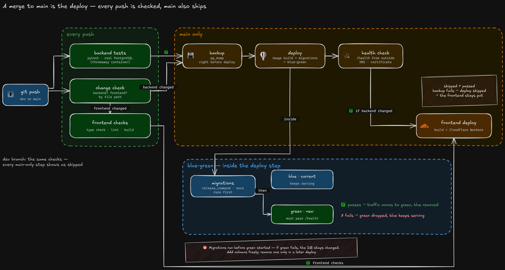

# CI/CD — merging to main is the deploy

Until 11-10, every deploy was a checklist run by hand — tests, a manual backup, `fly deploy` from a
laptop, then the frontend. Steps could be skipped; once, the backup was. And it could only run from
that laptop.

Now a merge to main runs the whole checklist on GitHub's servers — a merge from a phone is enough.



<sub>Source (.excalidraw) in [architecture/](./architecture/).</sub>

```
every push   tests (backend · frontend if changed)
main only    backup → backend deploy → health check from outside → frontend deploy
```

---

## Decisions

| Decision | Why |
|---|---|
| **Deploy only when the backend changed** | One machine. A docs-only merge would interrupt connections and take a backup with nothing new in it |
| **Back up right before every deploy** | Not just the nightly one. It reuses the nightly backup job, so backup logic lives in one place |
| **Blue-green** | The default, rolling, replaces the only machine in place — a broken release takes the site down at that moment. Blue-green starts the new machine beside the old one and moves traffic only after it passes its health check. Possible because nothing is stored on the machine. A second check from outside covers what the platform cannot see: DNS and the certificate, the path a parent actually takes |
| **Backend first, then frontend** | A new screen must not call an API the old server does not have yet. This holds because backend changes only add to the API |
| **"Skipped" is not "passed"** | If the backup fails, the deploy is skipped — counting that as fine would ship a frontend calling an API that never went out |
| **Deploys queue; they are never cancelled** | A deploy stopped halfway — migrations done, machine not switched — is worse than waiting |
| **The laptop deploy stays, as an emergency exit** | For the day GitHub is down. Whoever uses it pushes the same code to main right after, or the next automatic deploy silently overwrites the fix |

---

## Migrations and backups

```
Migrations   run by release_command, inside the deploy step
             🔴 Why migrations live in release_command and not in the container start command (CMD):
                In CMD they would run on every machine restart, and with several machines they would
                run at the same time and collide. release_command runs exactly once per deploy, before
                the new version comes up. If it fails, the new version never starts, so code that does
                not match the schema never reaches production.

Backups      GitHub Actions, daily → pg_dump → separate R2 storage, kept 30 days
             + one more right before every backend deploy (same job, same storage)
             A cron monitor alerts if the nightly job fails or never runs at all · a restore was tested once
```

---

## The one thing blue-green does not undo

Migrations run before the new machine starts. If the new version then fails, the old code keeps
serving — on the new schema. Adding a column is safe; the old code ignores it. Removing or renaming
one is split across two deploys: stop using it, then drop it. A failed deploy that already changed the
schema is restored by hand from the pre-deploy backup.
